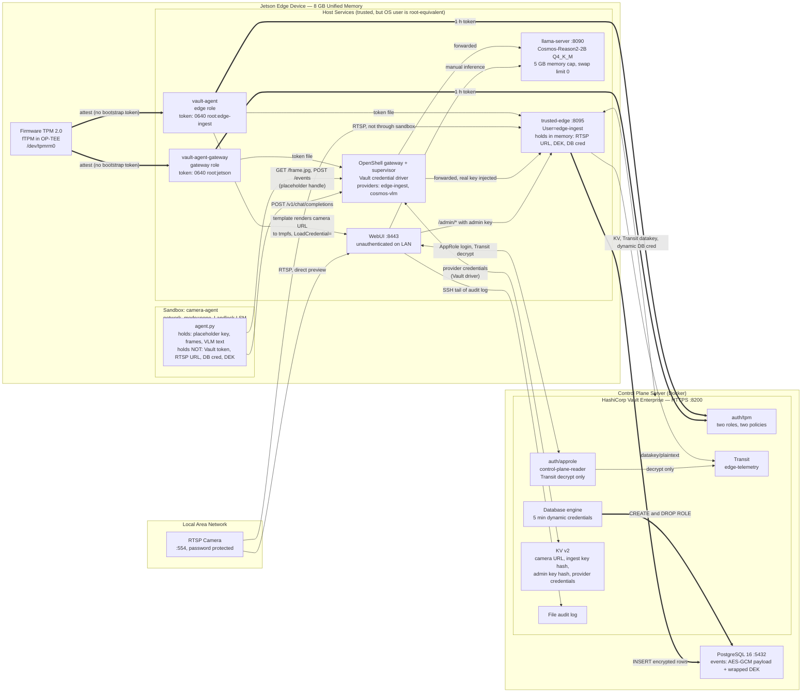

# System Architecture

> **Document Purpose:** Structural overview of the edge device governance architecture. Outlines the runtime components, communication channels, and trust boundaries across the system.
>
> **Related Documents:**
> - Step-by-step cryptographic sequence diagrams: [`CREDENTIAL_ARCHITECTURE.md`](CREDENTIAL_ARCHITECTURE.md)
> - TPM enrollment and attestation sequence diagrams: [`TPM_ATTESTATION_ARCH.md`](TPM_ATTESTATION_ARCH.md)
> - Threat analysis and security register: [`THREAT_MODEL.md`](THREAT_MODEL.md)

---

## High-Level Topology

---

## System Components

| Component | Host Environment | Core Responsibility | Sensitive Material Held |
|---|---|---|---|
| **Firmware TPM 2.0** | Jetson (`/dev/tpmrm0`) | Proves device identity to Vault using Endorsement Key (EK) challenge-response | EK private key (isolated in hardware/OP-TEE) |
| **`vault-agent` (edge)** | Jetson (systemd) | Performs TPM attestation; writes and renews 1-hour token for `trusted-edge` | Edge-role Vault token (`0640 root:edge-ingest`) |
| **`vault-agent-gateway`** | Jetson (systemd) | Performs TPM attestation; writes and renews 1-hour token for OpenShell gateway | Gateway-role Vault token (`0640 root:jetson`) |
| **`trusted-edge.service`** | Jetson (`User=edge-ingest`) | Ingest pipeline daemon: captures RTSP frames, performs envelope encryption, and writes to PostgreSQL | RTSP URL, Data Encryption Key (DEK), Dynamic DB credentials (in volatile memory only) |
| **OpenShell Gateway & Supervisor** | Jetson (`User=jetson`) | Executes sandbox container, enforces Landlock filesystem policy and deny-by-default network policy, injects wire credentials | Provider credentials (fetched from Vault) |
| **Sandbox (`camera-agent`)** | Jetson (container) | Executes autonomous vision loop: fetches frames, requests VLM inference, evaluates motion/objects, posts events | Opaque provider handle, raw image frames, model text output (no credentials) |
| **`llama-server`** | Jetson (container) | Serves vision-language model (`Cosmos-Reason2-2B`) via OpenAI-compatible HTTP API | Vision-language model weights |
| **WebUI Dashboard** | Jetson (systemd) | Live operator dashboard: camera stream, jtop telemetry, Vault widgets, side-by-side audit view | Camera URL (`LoadCredential=`), Admin key, AppRole secret, Control plane SSH key |
| **HashiCorp Vault Enterprise** | Control Plane (Docker) | Manages identity (`auth/tpm`), dynamic database credentials, Transit encryption keys, and secrets KV engines | Master encryption keys, root database credentials |
| **PostgreSQL 16** | Control Plane (Docker) | Stores encrypted event records and encrypted datakey references | Ciphertext event records |

---

## Trust Boundaries & Isolation Guarantees

1. **Sandbox Isolation:** The autonomous agent runtime (`agent/agent.py`) is strictly quarantined inside an OpenShell container with `network_mode=none` and Landlock LSM filesystem constraints. Outbound socket creation is intercepted by the local supervisor; unapproved egress attempts are rejected at the network boundary.
2. **Host Privileges:** Host services on the edge device are trusted relative to the sandbox, but separated from one another via Linux user boundaries (`edge-ingest` vs `jetson`) and file modes (`0640`). As noted in [`THREAT_MODEL.md`](THREAT_MODEL.md), the `jetson` OS user possesses `sudo` and `docker` group membership.
3. **Control Plane Isolation:** The control plane host is trusted. Vault dynamically provisions least-privilege credentials and rotates the database superuser password upon initial configuration.
4. **Relationship to WebUI Architecture View:** The interactive SVG architecture tab in the live dashboard (`ui/static/arch-scene.js`) isolates and visualizes the core security and credential governance flows (TPM attestation, token renewal, provider credential injection, Landlock containment). The diagram in this document provides the comprehensive system topology, including auxiliary management channels (WebUI direct preview, manual inference triggers, and SSH audit log tailing).
