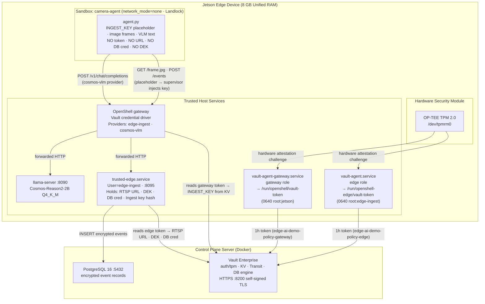

# Architecture Guide: Hardware-Rooted Credential Flow (Vault + NVIDIA OpenShell + Jetson)

> **Document Purpose:** Technical reference for edge credential governance. Covers hardware TPM 2.0 attestation, Vault Agent token workflows, the `trusted-edge` ingest service, the NVIDIA OpenShell gateway with Vault credential provider integration, and runtime sandbox isolation.
>
> **Related Documents:**
> - System component topology: [`ARCHITECTURE.md`](ARCHITECTURE.md)
> - TPM enrollment and attestation sequence diagrams: [`TPM_ATTESTATION_ARCH.md`](TPM_ATTESTATION_ARCH.md)
> - Threat analysis and security register: [`THREAT_MODEL.md`](THREAT_MODEL.md)

---

## 1. The Edge Security Challenge

Autonomous AI agents executing on edge hardware require access to:
- **Video feeds** (RTSP camera credentials)
- **Local inference backends** (VLM execution endpoints)
- **Centralized databases** (remote PostgreSQL for event records)

Storing static credentials directly on edge storage or inside agent configuration files creates severe exfiltration vulnerabilities if the Python runtime, model parsing logic, or physical device is compromised.

This architecture addresses the challenge through three foundational controls:
1. **Runtime Sandboxing:** The AI agent executes in an isolated container with `network_mode=none` and Landlock LSM filesystem restrictions; all outbound network traffic routes strictly through the OpenShell supervisor, which enforces deny-by-default network policy.
2. **Secret Isolation via Trusted Service:** Sensitive credentials (camera URLs, database credentials, Transit Data Encryption Keys) reside exclusively in the volatile memory of a dedicated host daemon (`trusted-edge.service`). The sandbox agent never receives these secrets.
3. **Hardware-Rooted Machine Identity:** Two distinct Vault Agent instances authenticate to HashiCorp Vault using the device's hardware TPM 2.0 module (`/dev/tpmrm0`), eliminating static bootstrap tokens on edge hardware.

---

## 2. System Architecture



---

## 3. End-to-End Cryptographic Sequence

```mermaid
sequenceDiagram
    autonumber
    participant AG  as agent.py (sandbox)
    participant SUP as OpenShell supervisor
    participant GW  as OpenShell gateway
    participant TE  as trusted-edge.service
    participant VLM as llama-server :8090
    participant VA1 as vault-agent.service (edge)
    participant VA2 as vault-agent-gateway.service
    participant TPM as Firmware TPM 2.0 (/dev/tpmrm0)
    participant V   as Vault Enterprise (Control Plane)
    participant DB  as PostgreSQL 16 (Control Plane)

    rect rgb(20, 30, 50)
    Note over VA1,V: Hardware Attestation: Two TPM Roles
    VA1->>TPM: vault tpm attest (hardware challenge — unauthenticated)
    V-->>VA1: token (1h, edge-ai-demo-policy-edge) → /run/openshell-edge/vault-token 0640
    VA2->>TPM: vault tpm attest (hardware challenge — unauthenticated)
    V-->>VA2: token (1h, edge-ai-demo-policy-gateway) → /run/openshell/vault-token 0640
    end

    rect rgb(20, 45, 35)
    Note over TE,V: Service Initialization: trusted-edge Secret Retrieval
    TE->>V: KV read camera-creds → rtsp_url (volatile memory only)
    TE->>V: Transit datakey/plaintext → DEK (volatile memory only)
    TE->>V: DB creds/edge-camera-agent → user+pass 5m TTL (volatile memory only)
    TE->>V: KV read ingest-key → SHA-256 hash (volatile memory only)
    end

    rect rgb(25, 35, 55)
    Note over GW,V: Gateway Startup: Provider Credential Loading
    GW->>V: read provider-credentials/<sha256> → INGEST_KEY plaintext
    end

    rect rgb(20, 45, 35)
    Note over AG,TE: Autonomous Execution Loop
    AG->>SUP: GET /frame.jpg (opaque handle)
    SUP->>TE: GET /frame.jpg (real X-Edge-Key injected by supervisor)
    TE-->>AG: 200 JPEG frame
    AG->>SUP: POST /v1/chat/completions (cosmos-vlm provider)
    SUP->>VLM: POST /v1/chat/completions
    VLM-->>AG: VLM analysis text
    AG->>SUP: POST /events (opaque handle)
    SUP->>TE: POST /events (real X-Edge-Key injected by supervisor)
    TE->>TE: Local AES-256-GCM encryption with DEK
    TE->>DB: INSERT events (vault:v1:... wrapped DEK + ciphertext payload)
    end
```



### Step-by-step walkthrough

A *provider* is an OpenShell object that carries the credential a sandbox needs to call one specific service, together with the endpoints and binaries allowed to use it. The sandbox receives only an opaque placeholder for that credential; the real value is substituted on the wire by the supervisor. This demo has two providers: `edge-ingest` (carries `INGEST_KEY`) and `cosmos-vlm` (no credential; it only permits the route to `llama-server`).

1. **Hardware attestation.** Each `vault-agent` instance proves the identity of the Jetson to Vault through the TPM, using the `auth/tpm` method. No static bootstrap token is involved. Vault returns a 1-hour token under a separate role and policy per instance: `edge-ai-demo-policy-edge` for the edge agent and `edge-ai-demo-policy-gateway` for the gateway agent. Each agent writes its token to its own file under `/run` (`0640`) and renews it automatically.
2. **`trusted-edge` loads its secrets.** At startup the service reads the edge token file and uses it to fetch four values from Vault: the camera RTSP URL (KV), a Transit data encryption key (DEK), a short-lived PostgreSQL credential (5-minute TTL), and the SHA-256 hash of the ingest key (KV); [why only the hash is loaded](#why-trusted-edge-holds-only-a-hash-of-the-ingest-key) is explained below the list. All four values are held in process memory only. The database credential is renewed by a background thread shortly before it expires; the DEK is replaced on the next event write once it is close to expiry.
3. **The gateway loads the provider credential.** The OpenShell gateway reads its own token file and uses it to read the plaintext `INGEST_KEY` from its dedicated Vault mount (`edge-ai-demo-gateway/`). The gateway keeps it in memory; the sandbox never receives it.
4. **The sandbox starts with a placeholder.** The `camera-agent` sandbox is created with the `edge-ingest` provider. Inside it, the environment variable `INGEST_KEY` contains only the string `openshell:resolve:env:v<N>_INGEST_KEY`. The sandbox also has no Vault token, no RTSP URL, no database credential and no DEK.
5. **The agent requests a frame.** `agent.py` sends `GET /frame.jpg` with the placeholder in the `X-Edge-Key` header. The request leaves through the OpenShell supervisor, which is the only network path out of the sandbox and applies the deny-by-default egress policy.
6. **The supervisor substitutes the real key.** If the destination and binary match the provider's rules, the supervisor replaces the placeholder with the real `INGEST_KEY` and forwards the request to `trusted-edge`. Anything else is denied (the sandboxed process sees `Errno 13`).
7. **`trusted-edge` authenticates and serves the frame.** It hashes the key it received with SHA-256 and compares the result to the hash it loaded in step 2 (see [the hash explanation](#why-trusted-edge-holds-only-a-hash-of-the-ingest-key) below). The comparison uses a constant-time function (`hmac.compare_digest`): an ordinary string comparison stops at the first differing character, so the time it takes can reveal how many leading characters were right, and an attacker who measures response times could in principle learn a secret one character at a time. A constant-time comparison always takes the same time whether the values differ at the first or the last position. Here the compared values are hashes of attacker-chosen input, so an attacker cannot steer the comparison toward a chosen hash prefix; the constant-time function is an additional safeguard, not the only protection. Failed attempts are also rate-limited (HTTP 429 after repeated failures; register entry [T-11](THREAT_MODEL.md#t-11)). On success it returns the latest JPEG frame, which it captured itself from the camera using the RTSP URL it holds.
8. **The agent asks the vision model.** The agent sends the frame to `llama-server` (`POST /v1/chat/completions`) through the supervisor, under the `cosmos-vlm` provider rule, and receives a text description. The frame and the model text are the only sensitive data the sandbox ever holds.
9. **The agent posts an event.** `agent.py` sends `POST /events` with the same placeholder. The supervisor substitutes the real key again, and `trusted-edge` authenticates it as in step 7. It also checks body size and the allowed event types and states.
10. **Envelope encryption and storage.** `trusted-edge` encrypts the event text locally with AES-256-GCM using the DEK, then inserts one row into PostgreSQL with the database credential it holds. The `raw_payload` column holds base64 of the nonce and ciphertext; `encrypted_datakey` holds the Transit-wrapped form of the DEK (`vault:v1:...`). No plaintext event text is written to the database.

#### Why `trusted-edge` holds only a hash of the ingest key

`trusted-edge` only has to *check* the key that callers present (steps 2 and 7); it never has to *use* that key to call anything. It is therefore given the SHA-256 hash of the key and never the key itself.

- **A hash cannot be used as the key.** `trusted-edge` hashes whatever a caller sends. Presenting the stored hash would produce the hash of the hash, which does not match, so reading the hash from Vault or from `trusted-edge` memory does not give an attacker a working key.
- **The plaintext is held elsewhere.** The key is a 256-bit random value generated once. At run time the plaintext is held only by the OpenShell gateway, which reads it from its own Vault mount (`edge-ai-demo-gateway/`); the edge policy does not grant that mount (`vault/policies/edge-agent-policy.hcl:9`).
- **The hash cannot be replaced by the edge token.** The edge policy allows only `create` and `read` on the hash path (`edge-agent-policy.hcl:39-45`), so a stolen edge token cannot write a hash of the attacker's own key ([T-07](THREAT_MODEL.md#t-07)). Rotation means a root-side delete on the control plane.
- **Limit.** This reduces what a leak of `trusted-edge` memory or of the Vault path gives away. It does not make a compromised `trusted-edge` harmless: that process still holds the camera URL, the DEK and the database credential ([T-02](THREAT_MODEL.md#t-02)). The key also exists briefly in a root-only handoff file during setup ([T-08](THREAT_MODEL.md#t-08)).

**Limits of this design**
- The placeholder substitution covers HTTP-shaped credentials such as headers and bearer tokens. RTSP and PostgreSQL credentials have not been tested through this mechanism, which is why `trusted-edge` holds them instead of a provider.
- Rotating a provider credential does not reach a running sandbox. It keeps the old placeholder mapping until it is recreated ([T-19](THREAT_MODEL.md#t-19)).

---

## 4. Key Security Guarantees & Verification

| Architectural Layer | Implementation Mechanism | Verification Proof | Security Guarantee |
|---|---|---|---|
| **Hardware Identity** | OP-TEE TPM 2.0 + Vault `auth/tpm` | *verified* TPM attestation with zero static bootstrap tokens | Machine identity is physically rooted in silicon; client certificates and tokens cannot be cloned to another device. |
| **Least-Privilege Policies** | Two independent TPM roles and policies | *verified* by token policy inspection and permission cross-checks | Compromise of the gateway token cannot access camera credentials or the database; compromise of the edge token cannot alter provider registrations. |
| **Secret Isolation from Sandbox** | `trusted-edge.service` acts as exclusive secret proxy | *verified* by comprehensive secret scanning (0 unexpected token/key hits in sandbox) | Compromise of the sandbox agent does not expose camera passwords, database credentials, or encryption keys. |
| **Provider Wire Substitution** | `openshell:resolve:env:KEY` $\to$ supervisor injects `X-Edge-Key` | *verified* by HTTP header inspection and environment scans | Ingest API key is never present in sandbox environment variables, memory, or log output. |
| **Deny-by-Default Network Egress** | `network_mode=none` + OpenShell supervisor policy | *verified* via network probes (unauthorized egress denied with `Errno 13`) | Sandboxed processes cannot establish unauthorized outbound TCP/UDP connections. |
| **Landlock Filesystem Containment** | Landlock LSM ABI 3 | *verified* kernel Landlock rule application (`rules_applied: 15`) | Agent process is restricted to designated directories; system paths (`/etc/shadow`, `/root`, `~/.ssh`) are inaccessible. |
| **Dynamic Database Credentials** | Vault database secrets engine (5 min TTL) | *verified* lease expiration and `pg_terminate_backend` revocation | Leaked database credentials expire within 5–10 minutes; revocation terminates active database sessions. |
| **Database Root Password Rotation** | Vault `rotate-root` on initial connection setup | *verified* bootstrap `.env` password rejected over TCP; dynamic roles functional | Static database root password is known exclusively to Vault's barrier storage. |
| **Transit Envelope Encryption** | AES-256-GCM via Vault Transit Data Encryption Key | *verified* database record inspection: `encrypted_datakey` holds the Transit-wrapped DEK (`vault:v1:...`); `raw_payload` holds base64 AES-256-GCM ciphertext without that prefix | Event records are encrypted before leaving the edge device; raw payloads are unreadable in PostgreSQL storage. |
| **Zero-Swap VLM Container** | Runtime swap lock script (`vlm-swap-lock.sh`) | *verified* cgroup measurement (`memory.swap.max = 0`, `VmSwap = 0`) after container start and after repeated reloads; behaviour across a reboot is not verified | Vision model memory cannot page to disk-backed swap or push sensitive daemon pages into swap storage. |
| **Dual Audit Logging** | OpenShell supervisor logs + Vault audit device | *verified* supervisor network logs and Vault JSON audit stream | Full end-to-end attribution for network decisions and cryptographic secret operations. |

---

## 5. TPM 2.0 Remote Enrollment Model

To maintain strict security separation, the Vault root administrative token remains exclusively on the control plane server during enrollment:

```
Workstation / Control Plane                 Jetson Edge Device
───────────────────────────                 ──────────────────
1. SSH trigger (unauthenticated) ─────────> tpm2_createek -G rsa
                                            (reads Endorsement Key pubkey)
2. EK PEM returned over SSH <────────────── Sends public key PEM
3. vault write identity/tpm
   (registers EK with root token)
4. SSH trigger attestation ───────────────> vault tpm attest
                                            (unauthenticated challenge/response)
5. Vault Agent daemon active <────────────> Auto-renews 1h tokens via TPM
```

Full sequence diagrams and CLI specifications are detailed in [`TPM_ATTESTATION_ARCH.md`](TPM_ATTESTATION_ARCH.md).

---

## 6. Production Architecture Evolution & Multi-Agent Roadmap

While this proof of concept demonstrates single-agent credential governance using OpenShell v0.1.4's built-in Vault driver, the architecture supports several key enterprise production evolutions:

### 1. System-of-Record Vault Credential Driver
- **Current State:** OpenShell's built-in driver stores provider credentials in a dedicated Vault mount (`edge-ai-demo-gateway/`), which requires coordinating the provider configuration with the backend KV store.
- **Production Target:** Transition to the custom OpenShell Vault Credential Driver (`openshell-credential-driver-vault`). This driver implements NVIDIA's `CredentialDriver` contract, allowing OpenShell to store `vault+kv2://` URI references directly. Vault remains the single system of record, eliminating the credential synchronization risk identified in [T-27](THREAT_MODEL.md#t-27).

### 2. Actor Chain Delegation for Multi-Agent Edge Sandboxes
- **Multi-Agent Scaling:** When a single OpenShell gateway hosts multiple sandboxes, relying on a single gateway token aggregates all audit events into one identity.
- **Delegation Model:** The gateway can be configured with a Vault token role that permits creating short-lived child tokens aliased to specific sandbox names. When OpenShell resolves credentials (`vault+token://role`), Vault mints an ephemeral child token tied to that specific agent identity. This provides granular, per-agent audit attribution and policy enforcement while ensuring the agent itself never directly holds Vault credentials.

### 3. Automated Fleet Enrollment via Ansible
- In production environments, TPM Endorsement Key extraction, Vault identity enrollment, and agent entity alias pre-registration can be automated in a single Ansible enrollment playbook during hardware staging.
