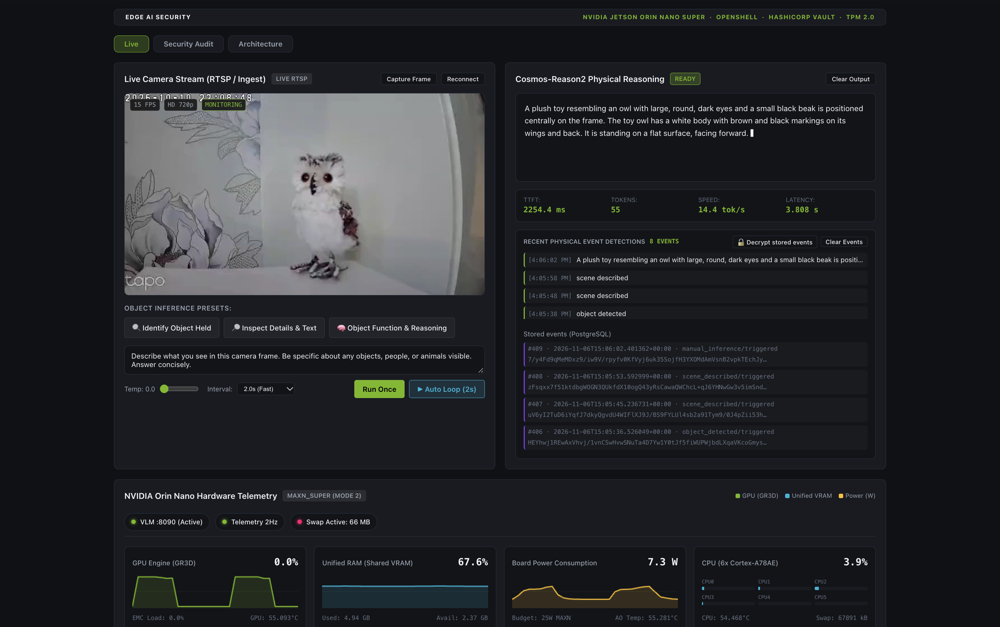
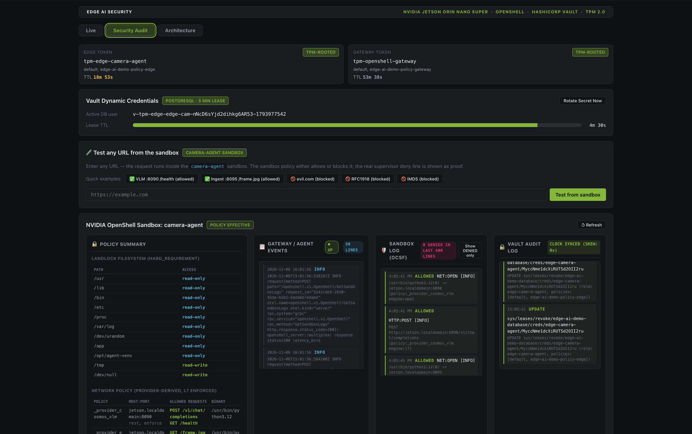
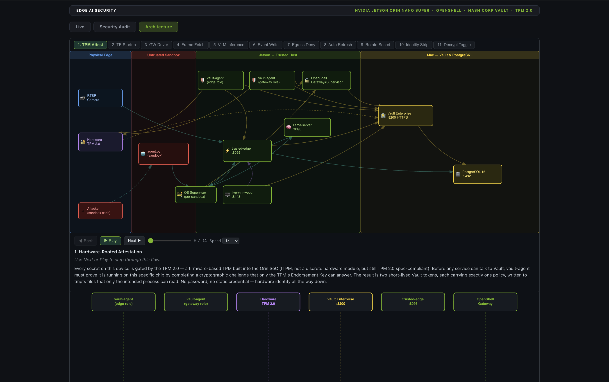

# Hardware-Rooted AI Agent Security at the Edge: HashiCorp Vault + NVIDIA OpenShell + Jetson Orin Nano

> **Document Purpose:** A proof-of-concept demonstrating hardware-rooted identity, runtime sandboxing, and dynamic credential governance for AI agents at the edge.
>
> **Related Documents:**
> - System component topology: [`ARCHITECTURE.md`](ARCHITECTURE.md)
> - End-to-end credential flow sequence diagrams: [`CREDENTIAL_ARCHITECTURE.md`](CREDENTIAL_ARCHITECTURE.md)
> - TPM enrollment and attestation sequence diagrams: [`TPM_ATTESTATION_ARCH.md`](TPM_ATTESTATION_ARCH.md)
> - Threat analysis and security register: [`THREAT_MODEL.md`](THREAT_MODEL.md)
> - Installation script modes, flags, and stages: [`COMMANDS.md`](COMMANDS.md)

---

## Architectural Highlights

Modern AI agents operating on edge devices require access to databases, inference endpoints, and external APIs. Storing static credentials on edge hardware creates significant exfiltration risks if the agent runtime or host is compromised.

In this architecture, an autonomous vision-language camera agent runs locally on an NVIDIA Jetson edge device to analyze a live video feed in real time. Detected events are cryptographically secured on the device and forwarded to a remote database for persistent storage.

This project demonstrates how **HashiCorp Vault Enterprise** and **NVIDIA OpenShell** combine to secure this end-to-end autonomous edge workflow:

1. **Hardware-Rooted Identity (TPM 2.0):** The Jetson authenticates to Vault using its onboard TPM (`/dev/tpmrm0`) via Vault's `auth/tpm` engine. No root token or bootstrap secret ever resides on edge storage. Two separate TPM roles enforce least privilege: one for the trusted ingest pipeline and one for the OpenShell gateway.
2. **Strict Sandbox Isolation:** NVIDIA OpenShell executes the camera agent inside a container with `network_mode=none` and Landlock LSM filesystem restrictions. The container cannot make direct network calls; all outbound requests pass through the OpenShell supervisor, which enforces deny-by-default network policies. Unauthorized egress is blocked at the network boundary.
3. **Credential Non-Disclosure:** The agent script (`agent/agent.py`) never receives a Vault token, database credentials, camera passwords, or encryption keys. The OpenShell supervisor intercepts approved HTTP calls and injects provider credentials on the wire from opaque placeholders (`openshell:resolve:env:...`).
4. **Dynamic & Ephemeral Secrets:** Vault dynamically provisions short-lived PostgreSQL credentials (5-minute TTL, revoked with `pg_terminate_backend` on expiry) and AES-256-GCM Transit envelope encryption. Additionally, Vault automatically rotates the PostgreSQL superuser password upon initial configuration so that the static root database secret is known only to Vault.
5. **Edge Resource Optimization:** Serves `Cosmos-Reason2-2B` (GGUF Q4_K_M vision-language model, ~2.1 GB total weights) using an accelerated `llama.cpp` container. Headless system configuration, unified memory management, and runtime swap locking keep peak memory within the Jetson Orin Nano's 8 GB physical budget while preventing inference memory from paging to swap.
6. **Dual Audit Trail:** The OpenShell supervisor logs every network policy decision (`openshell logs camera-agent --source sandbox`), while Vault records every secret generation, access, and lease revocation event.

---

## Architecture Summary

```
┌──────────────────────────────────────────────────────────────────────────┐
│  Jetson Orin Nano Super (8 GB RAM, JetPack 7.2.1, Ubuntu 24.04)          │
│                                                                          │
│  TPM 2.0 (/dev/tpmrm0)  ──────────────────────────────────────────────  │
│    ├─ vault-agent (edge role)  →  /run/openshell-edge/vault-token 0640   │
│    └─ vault-agent-gateway      →  /run/openshell/vault-token      0640   │
│                                                                          │
│  trusted-edge.service  (User=edge-ingest, :8095)  ──────────────────── │
│    Holds in memory: RTSP URL · Transit DEK · dynamic DB cred            │
│    Routes: GET /frame.jpg  POST /events  POST /admin/events              │
│                                                                          │
│  OpenShell gateway  (Vault credential driver)  ─────────────────────── │
│    Providers: edge-ingest (X-Edge-Key header)  cosmos-vlm (inference)   │
│                                                                          │
│  Sandbox: camera-agent  (persistent, restart-policy always)  ─────────  │
│    agent.py: GET /frame.jpg → VLM → POST /events                        │
│    Holds: opaque INGEST_KEY placeholder only (no token/URL/DEK/DB cred) │
│                                                                          │
│  llama-server :8090  (Cosmos-Reason2-2B Q4_K_M, ~2.1 GB)               │
│  Live VLM WebUI :8443  (RTSP stream + telemetry + Vault audit tail)      │
└───────────────────────────────────┬──────────────────────────────────────┘
                                    │ TPM attestation · dynamic DB/Transit
┌───────────────────────────────────▼──────────────────────────────────────┐
│  Mac / Linux Control Plane (Docker)                                      │
│                                                                          │
│  HashiCorp Vault Enterprise v2.2.0+ent  (HTTPS :8200, TLS)              │
│    ├─ auth/tpm  ·  identity/tpmgroup  (hardware attestation)            │
│    ├─ edge-ai-demo-database/  (dynamic creds, 5 min TTL; root rotated)   │
│    ├─ edge-ai-demo-encryption-transit/  (Transit AES-256-GCM datakey)   │
│    ├─ edge-ai-demo-kv/  (camera RTSP URL, ingest-key hash)              │
│    └─ edge-ai-demo-gateway/  (provider credential store)                │
│                                                                          │
│  PostgreSQL 16  (events table: encrypted_datakey + AES-GCM payload)     │
└──────────────────────────────────────────────────────────────────────────┘
```

Detailed diagrams and flow specifications:
- System boundaries and components: [`ARCHITECTURE.md`](ARCHITECTURE.md)
- Step-by-step cryptographic sequence: [`CREDENTIAL_ARCHITECTURE.md`](CREDENTIAL_ARCHITECTURE.md)
- TPM 2.0 attestation sequence: [`TPM_ATTESTATION_ARCH.md`](TPM_ATTESTATION_ARCH.md)

---

## Live WebUI Dashboard

The edge device serves an HTTPS dashboard at `https://<jetson-ip>:8443` featuring three tabs for real-time operation, policy inspection, and architecture visualization:

### Tab 1 — Live Video, VLM Inference & Vault Controls
Displays the live camera stream, real-time Cosmos-Reason2-2B vision-language inferences, TPM-attested identity status, dynamic PostgreSQL credential auto-rotation with immediate lease revocation, and client-side payload decryption toggles:



### Tab 2 — Security Audit & Dual Audit Trail
Provides interactive URL egress probing against the OpenShell sandbox boundary, live Landlock/network policy enforcement events with OCSF deny logging, and concurrent HashiCorp Vault audit trail telemetry:



### Tab 3 — Interactive Architecture & Sequence Flows
Visualizes the end-to-end component topology, trust zones, and step-by-step cryptographic packet animations across all 11 runtime sequences:



---

## Quickstart & Deployment

### Prerequisites

Three environments are involved: your **workstation** (orchestrates installation via SSH), the **control plane server** (runs Docker + Vault Enterprise + PostgreSQL), and the **Jetson edge device**.

#### 1. Workstation
- Operating System: macOS or Linux
- Tools: `bash`, `ssh`, `scp`, `rsync`, `openssl`, `shasum`
- Configuration: `.env` file copied from `.env.example` and configured with IP addresses, SSH keys, camera credentials, and a valid `VAULT_LICENSE_STRING`.
- SSH access: Authorized SSH keys to both the Control Plane server and the Jetson device.

#### 2. Control Plane Server
- Hardware: macOS or Linux server accessible on the local network.
- Software: Docker Desktop or Docker Engine, Homebrew / system OpenSSL 3.x, and the `vault` CLI.
- Network Ports: `8200` (Vault HTTPS) and `5432` (PostgreSQL).

#### 3. Jetson Edge Device
- Hardware: NVIDIA Jetson Orin Nano (8 GB unified memory), initialized iGPU, TPM 2.0 module (`/dev/tpmrm0`).
- Software: NVIDIA JetPack 7.2.1 / L4T 39.2.1 (Ubuntu 24.04 aarch64), Docker with NVIDIA container runtime.
- Vault Enterprise Binary: The Vault Enterprise `vault` aarch64 binary must be placed at `/usr/local/bin/vault` on the Jetson to support TPM attestation and Vault Agent auto-auth (`chmod +x /usr/local/bin/vault`).
- Outbound Internet Access: Required during setup to download OS packages (`tpm2-tools`), the OpenShell installer, container images, and the Cosmos-Reason2-2B GGUF model weights.

---

### Step-by-Step Installation

#### 1. Configure Environment
Copy the example environment file and customize it for your network:
```bash
cp .env.example .env
```
Ensure all required variables are populated, including `MAC_IP`, `JETSON_IP`, `VAULT_LICENSE_STRING`, `CAMERA_RTSP_URL`, `POSTGRES_USER`, and `POSTGRES_PASSWORD`.

#### 2. Run the Unified Installer
From your workstation, execute the end-to-end installation script (target IPs and credentials are read directly from `.env`):
```bash
./scripts/install-all.sh
```

For the options of `install-all.sh` and of the scripts it calls (single stages, resets, cleanup), see [`COMMANDS.md`](COMMANDS.md).

The installer automates the full deployment pipeline across both hosts:
1. **Control Plane Setup (`bootstrap-mac.sh`):** Generates self-signed TLS certificates with SAN entries, starts Vault Enterprise and PostgreSQL containers, initializes and unseals Vault, configures secret engines, and provisions least-privilege policies.
2. **TPM Enrollment Gate:** Verifies `tpm2-tools` availability on the Jetson and enrolls the hardware Endorsement Key (EK) in Vault (`auth/tpm`).
3. **Jetson Bootstrapping (`bootstrap-jetson.sh`):** Configures headless mode, pulls container runtimes, downloads model weights, provisions `trusted-edge.service`, installs NVIDIA OpenShell, configures provider credentials, and launches the sandboxed `camera-agent`.
4. **Verification & Smoke Testing:** Verifies token generation, Landlock egress blocking, database credential rotation, and payload encryption.

---

### Database Root Password Auto-Rotation

During initial initialization (`vault/init-vault.sh`), Vault configures the PostgreSQL secrets engine using the initial bootstrap credentials in `.env`, and then immediately issues a `rotate-root` command (`POST edge-ai-demo-database/rotate-root/edge-demo-postgres`).

Vault generates a cryptographically secure random password, updates the PostgreSQL database superuser over the connection, and stores the new credential inside its encrypted barrier. As a result:
- The initial `.env` password no longer opens PostgreSQL over the network.
- `trusted-edge.service` requests dynamic, short-lived user roles (`v-root-edge-cam-...`) with a 5-minute TTL.
- An existing deployment can be reset or re-synchronized using `DB_ROOT_RESET=1 make setup-vault` on the control plane.

---

### Automated Unseal After Reboot

On the control plane server, Docker will automatically restart the Vault and PostgreSQL containers upon host restart. However, Vault starts in a **sealed** state. The unseal after a restart is automated by a LaunchAgent that runs `scripts/mac-resume.sh` at each user login: it waits for Docker, starts the containers, waits for Vault, and runs `make setup-vault`, which unseals Vault using `.vault-keys.json`.

`./scripts/install-all.sh` installs this LaunchAgent automatically (the `resume` step of `bootstrap-mac.sh`), so no separate command is needed after a normal installation. To install it on its own, or to reinstall it:
```bash
make install-mac-resume
```
To remove it:
```bash
make uninstall-mac-resume
```
The job runs at user login, not at boot, so the Mac user must log in after a restart. The log is `.mac-resume.log` in the repository directory on the control plane server.

---

## Verification & Smoke Testing

To run the automated verification suite against the active deployment, execute the smoke test target on the control plane server:
```bash
make demo-smoke-test
```

The smoke test validates:
- **OpenShell Sandboxing:** Confirms the `camera-agent` sandbox is active, Landlock filesystem rules are applied, and unauthorized egress attempts are denied with `Errno 13`.
- **VLM Inference:** Verifies `llama-server` is healthy on port `8090` and correctly processes vision prompts using `Cosmos-Reason2-2B`.
- **Memory & Swap Enforcement:** Asserts the `vlm-server` container process has `VmSwap = 0`. Host-wide swap is not zero (idle pages of other daemons) and is only reported, not asserted.
- **Cryptographic Event Pipeline:** Verifies that event rows in PostgreSQL contain valid AES-256-GCM ciphertexts and Transit-wrapped keys (`vault:v1:...`).

To inspect the live dashboard, navigate to:
```text
https://<jetson-ip>:8443
```

---

## Important Notice

**This is a proof of concept (PoC), not a turnkey production reference architecture.**

It demonstrates one practical combination of **HashiCorp Vault Enterprise**, **NVIDIA OpenShell**, and an **NVIDIA Jetson Orin Nano** running on a local network. Before treating it as a production security blueprint, review the complete [Threat Model](THREAT_MODEL.md) and understand the security boundaries and accepted demo trade-offs:

| What the Sandbox Holds | What It Does NOT Hold |
|---|---|
| An opaque `openshell:resolve:env:...INGEST_KEY` provider placeholder | The real ingest API key (held only in Vault via the gateway) |
| Plaintext camera frames (needed for VLM inference) | The camera RTSP URL or password |
| VLM text responses (needed for event evaluation) | Any HashiCorp Vault token |
| | The database credential or Transit Data Encryption Key (DEK) |

Known accepted weaknesses in this PoC (full register in [`THREAT_MODEL.md`](THREAT_MODEL.md)):
- **Unauthenticated WebUI** — the local dashboard at `:8443` has no login ([T-13](THREAT_MODEL.md#t-13), [T-31](THREAT_MODEL.md#t-31))
- **Plaintext HTTP on LAN** — unencrypted communication between internal LAN endpoints, Vault HTTPS excepted ([T-14](THREAT_MODEL.md#t-14))
- **Self-signed Vault certificate** — CA pinned on the Jetson rather than issued by an enterprise PKI ([T-15](THREAT_MODEL.md#t-15), [T-41](THREAT_MODEL.md#t-41))
- **Single Vault node** — single-node Raft storage without automated KMS unseal or HA clustering ([T-16](THREAT_MODEL.md#t-16), [T-40](THREAT_MODEL.md#t-40))
- **`trusted-edge.service` host process** — holds the camera URL, DEK, and dynamic DB credential in memory ([T-02](THREAT_MODEL.md#t-02))
- **Host administrative user** — local `jetson` user is in `docker` and `sudo` groups; host OS is not hardened against administrative access ([T-04](THREAT_MODEL.md#t-04))
- **Token file permission isolation** — two Vault tokens separated by Linux file ownership and modes, not distinct hardware ([T-05](THREAT_MODEL.md#t-05))
- **Unpinned model/container supply chain** — floating image tag `:latest-jetson-orin` and public GGUF weights without cryptographic signature verification ([T-17](THREAT_MODEL.md#t-17))
- **VLM prompt injection** — event types are allow-listed, but raw VLM output is untrusted text parsed by keywords ([T-12](THREAT_MODEL.md#t-12))
- **Dynamic DB lease lifetime** — short-lived 5-minute TTL window before Vault revokes leaked credentials ([T-03](THREAT_MODEL.md#t-03))
- **Physical security** — device storage and unified memory are not full-disk encrypted; no secure boot enforcement ([T-18](THREAT_MODEL.md#t-18))

---

## Documentation Index

- [`ARCHITECTURE.md`](ARCHITECTURE.md) — System components, trust zones, and boundary diagrams.
- [`CREDENTIAL_ARCHITECTURE.md`](CREDENTIAL_ARCHITECTURE.md) — Cryptographic sequence from TPM attestation to wire credential injection.
- [`TPM_ATTESTATION_ARCH.md`](TPM_ATTESTATION_ARCH.md) — Hardware Endorsement Key enrollment and auto-attestation workflows.
- [`THREAT_MODEL.md`](THREAT_MODEL.md) — Comprehensive security register tracking defended, partially defended, and accepted threats.
- [`COMMANDS.md`](COMMANDS.md) — Modes, flags, stages, and make targets of the installation scripts.
- [`NOTICE`](NOTICE) — Trademarks and third-party software licensing attributions.
- [`LICENSE`](LICENSE) — Apache License 2.0 terms and conditions.

---

## License & Trademarks

This project is licensed under the Apache License, Version 2.0. See [`LICENSE`](LICENSE) for full details.

**Trademarks:** NVIDIA, Jetson, Orin, JetPack, Cosmos, and OpenShell are trademarks or registered trademarks of NVIDIA Corporation. HashiCorp and Vault are trademarks or registered trademarks of HashiCorp, Inc. IBM is a trademark of International Business Machines Corporation. Docker is a trademark of Docker, Inc. Linux is a trademark of Linus Torvalds. All other trademarks are the property of their respective owners and are used solely for product identification purposes. This project is not affiliated with, endorsed by, or sponsored by any of these organizations. For complete component notices, see [`NOTICE`](NOTICE).
