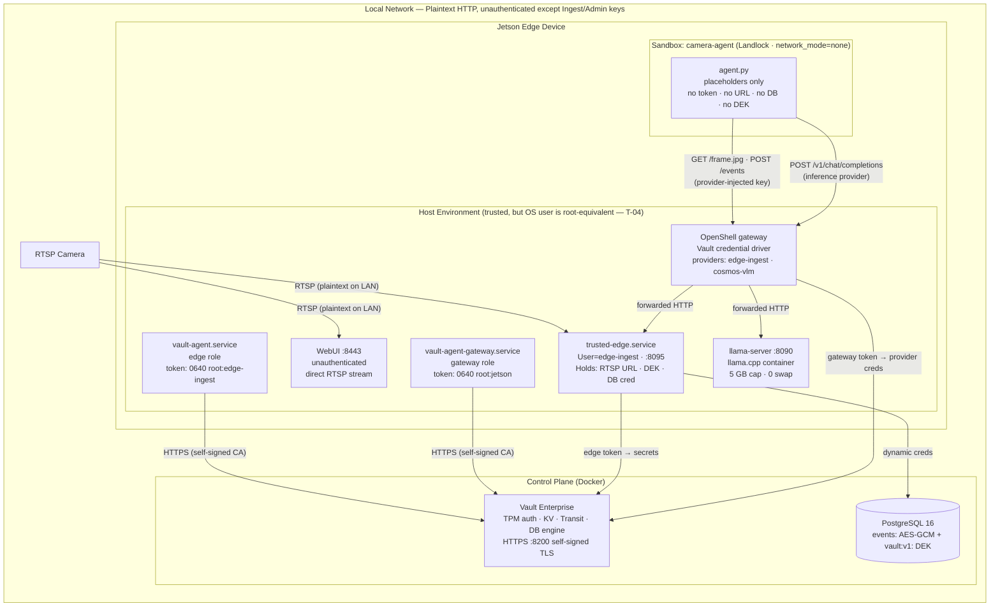

# Threat Model & Security Register

> **Document Purpose:** Living security register for the edge device governance proof of concept. Explicitly details what the architecture defends, what it only partly defends, and what it does **not** defend.
>
> **Related Documents:**
> - System component topology: [`ARCHITECTURE.md`](ARCHITECTURE.md)
> - End-to-end credential flow sequence diagrams: [`CREDENTIAL_ARCHITECTURE.md`](CREDENTIAL_ARCHITECTURE.md)
> - TPM enrollment and attestation sequence diagrams: [`TPM_ATTESTATION_ARCH.md`](TPM_ATTESTATION_ARCH.md)

> **Honest Scope Statement:** The system defends a sandboxed AI agent from accessing static credentials, enforces network egress policies from within the sandbox, and dynamically provisions short-lived database credentials. It does NOT harden the underlying edge host OS against administrative access, does not encrypt internal LAN traffic between plaintext HTTP services, does not authenticate the WebUI, and does not cryptographically pin model weights or container supply chains. These are accepted proof-of-concept trade-offs; each has a production remediation listed in the register.

---

## 1. Security Architecture Principles

- **Explicit Accountability:** Every threat entry has a persistent ID (`T-nn`), an objective status (**Defended**, **Partly defended**, **NOT defended**, **Accepted for demo**), an evidence label (*verified*, *documented*, *inferred*, *unverified*), and a production alternative.
- **Evidence-Based Claims:** No status is upgraded without direct technical verification. If a test is one-directional (e.g. testing that unprivileged access is denied without confirming privileged access succeeds), the limitation is noted.
- **Unambiguous Boundaries:** Host operating system privileges, network paths, and cryptographic scopes are documented as physically implemented.

---

## 2. Assets

| Asset | Storage / Execution Location | Security Sensitivity |
|---|---|---|
| Camera RTSP URL and password | Vault KV (`edge-ai-demo-kv/edge-device/camera-creds`); in memory of `trusted-edge` and WebUI (via systemd `LoadCredential=`) | Live video feed of monitored physical space; direct camera control |
| Data Encryption Key (DEK) | Vault Transit datakey (`edge-telemetry`), in process memory of `trusted-edge` only | Decrypts all stored historical event rows |
| Dynamic PostgreSQL credential | Vault database secrets engine (5–10 min TTL), in process memory of `trusted-edge` only | Read/write access to the `edge_demo` database |
| Ingest API key (plaintext) | OpenShell provider (`edge-ingest`) stored in Vault KV (`edge-ai-demo-gateway/`); gateway memory only | Authorizes pushing event metadata and fetching camera frames from `trusted-edge` |
| Ingest API key (SHA-256 hash) | Vault KV (`edge-ai-demo-kv/edge-device/ingest-key`) | Evaluated by `trusted-edge` on every incoming API request |
| Edge Vault token | `/run/openshell-edge/vault-token` (`0640 root:edge-ingest`, tmpfs) | Authorizes `trusted-edge` to read database credentials and request Transit operations |
| Gateway Vault token | `/run/openshell/vault-token` (`0640 root:jetson`, tmpfs) | Authorizes OpenShell gateway to read and resolve provider credentials |
| Vault root token & unseal key | Control plane host only (`.vault-keys.json`, `chmod 600`) | Complete administrative control over Vault |
| TPM 2.0 client certificates | `/etc/vault-agent/tpm-edge/` and `/etc/vault-agent/tpm-gateway/` (public material) | Cryptographic proof of hardware identity; private key never leaves TPM silicon |
| Camera frames & event records | Plaintext frames in volatile memory; Mac PostgreSQL (AES-256-GCM payload + Transit-wrapped DEK) | User privacy; forensic integrity |

---

## 3. Actors & Assumed Capabilities

| Actor | Assumed Capability & Boundary |
|---|---|
| Code inside Sandbox (`agent.py` or injected code) | Runs as unprivileged UID 1000 in a Docker container with `network_mode=none`; filesystem constrained by Landlock LSM; all network egress routed exclusively through the OpenShell supervisor |
| Local unprivileged OS user | Can inspect world-readable `/run` entries; cannot read `0640 root:edge-ingest` or `root:jetson` files without privilege escalation |
| Host administrative user (`jetson`) | Member of `docker` and `sudo` groups — **root-equivalent**; can inspect all host files, environment variables, and memory |
| Vision-Language Model (`llama-server`) | Produces unstructured text output; untrusted execution stream; parsed by `agent.py` strictly against an allow-list |
| LAN-adjacent host | Can reach open ports on the edge device (`8090`, `8095`, `8443`) and the control plane (`5432`, `8200`) |
| Physical device attacker | Has physical possession of the unencrypted Jetson device and NVMe storage |

---

## 4. Trust Boundaries

**Key Boundary Properties:**
- **Sandbox Boundary:** OpenShell supervisor + Landlock LSM enforce network and filesystem isolation.
- **Token Separation:** Two Vault tokens are separated by Linux filesystem permissions (`0640`), not separate physical machines ([T-05](#t-05)).
- **Host Security:** The `trusted-edge` daemon is the single point of convergence holding camera credentials, DEK, and dynamic database credentials in process memory ([T-02](#t-02)).

---

## 5. Security Threat Register

**Status Legend:**
- **Defended (D):** Control is implemented and technically verified.
- **Partly defended (P):** Control mitigates the threat but leaves known, documented residual risk.
- **NOT defended (N):** Known risk exists with no mitigation in the current proof of concept.
- **Accepted for demo (A):** Architectural trade-off intentionally accepted for the demo scope.

| ID | Threat Description | Status | Evidence | Current PoC Control | Production Alternative |
|---|---|:---:|---|---|---|
| **T-01** | Sandboxed agent reads camera credentials, DEK, or DB credentials | **D** | *verified* by secret scan across process environments, filesystem, and logs (0 unexpected hits; no `vault:v1:` ciphertext in sandbox logs; no RTSP credentials in environment). | The sandbox agent holds only an opaque handle `openshell:resolve:env:...INGEST_KEY`, image frames, and model text. All sensitive credentials reside exclusively in `trusted-edge.service`. | Same architectural split; host `trusted-edge` inside a hardware Confidential VM / TEE or separate micro-appliance. |
| **T-02** | Compromise of host `trusted-edge.service` | **N** | *inferred* | Host hardening in place: `User=edge-ingest`, `NoNewPrivileges=yes`, `ProtectSystem=strict`, empty `AmbientCapabilities`, `MemoryMax=400M`. Does not prevent compromise if vulnerability exists in runtime. | Minimal microkernel/Rust implementation; signed immutable container; hardware-isolated credential store (HSM/TEE); strict per-operation audit logging. |
| **T-03** | Leaked dynamic database credential used before lease expiry | **P** | *verified* TTL expiration and automatic revocation via `pg_terminate_backend`. | Dynamic credentials provisioned with 5-minute TTL (max 10 min). Revocation drops role and terminates active sessions. Exposure window is bounded by the lease duration. | Shorter TTL (1 min); network ACL restricting PostgreSQL connections strictly to edge IP; automated lease revocation on anomaly detection. |
| **T-04** | Host administrative user is root-equivalent | **A** | *verified* (`jetson` user is member of `docker` and `sudo` groups). | No mitigation. Anyone with local administrative login can inspect host memory and read `/run` token sinks. | Remove `docker`/`sudo` privileges from standard accounts; implement dedicated break-glass administration; require hardware FIDO2 SSH authentication. |
| **T-05** | Token separation relies on filesystem permissions only | **P** | *verified* cross-deny permissions (`edge-ingest` cannot read gateway token, `jetson` group cannot read edge token). | Tokens stored in separate files with distinct ownership and Vault policy associations. A root-level exploit can access both tokens. | Isolate gateway and ingest components on physically distinct hardware or distinct microVMs with individual TPM identities. |
| **T-06** | Token file permissions misconfigured without detection | **P** | *verified* token file mode (`0640`) and ownership verification in startup pipeline. | Vault Agent sink configuration explicitly sets `0640` file mode and dedicated service ownership (`root:edge-ingest` and `root:jetson`). | Automated permission validation in CI/CD; automated host integrity monitoring (AIDE/auditd); periodic runtime permission assertions. |
| **T-07** | Ingest key hash overwritten by compromised edge token | **D** | *verified* Vault policy enforcement (`edge-ai-demo-policy-edge` grants `create` and `read` only; `delete` and `update` on metadata denied). | Hash update is restricted; overwriting existing metadata is denied at the Vault policy level. Key replacement requires root administrative privileges. | Dedicated cryptographic signing of administrative updates; centralized Vault audit alerting on configuration write attempts. |
| **T-08** | Plaintext ingest API key stored on persistent disk | **D** | *verified* removal of temporary handoff files upon provider initialization; filesystem scans confirm absence. | Plaintext key exists only in Vault KV and volatile gateway process memory. Sandbox receives only an opaque resolution placeholder. | Ephemeral dynamic key negotiation; zero filesystem persistence during bootstrap. |
| **T-09** | Opaque credential placeholder mistaken for usable secret | **D** | *verified* by inspection of OpenShell provider handle behavior. | `openshell:resolve:env:...` is an internal supervisor lookup identifier, not a cryptographic secret. It possesses no value outside the supervisor proxy. | None needed (intended architectural behavior). |
| **T-10** | Sandbox reaches loopback or unauthorized network endpoints | **D** | *verified* by network policy egress test (unauthorized egress denied with `Errno 13 EACCES` and logged as `NET:OPEN ... DENIED`). | Network policy rejects loopback (`127.0.0.1`) and unauthorized LAN IPs. Sandboxed process must route through inspected endpoints. | Hardware network namespace enforcement; eBPF-based socket filtering. |
| **T-11** | Unauthorized LAN entity invokes `trusted-edge` endpoints | **P** | *verified* (HTTP 401 on missing/invalid key, 413 on oversized payload, 422 on invalid event type, 429 on authentication flooding). | Constant-time API key verification, payload size caps, strict event type allow-list, rate limiting (`AUTHFAIL_LIMIT = (10, 0.2)`). Traffic is plaintext HTTP on LAN. | Mutual TLS (mTLS) between supervisor and ingest service; firewall namespace binding per systemd cgroup. |
| **T-12** | VLM prompt injection or adversarial text output | **A** | *inferred* | Event types restricted to a strict allow-list on `trusted-edge`; model text cannot inject new schema types. Stored text is AES-256-GCM encrypted. | Constrained decoding / grammar-based sampling; strict JSON schema enforcement; independent output validation filter. |
| **T-13** | WebUI dashboard is unauthenticated | **P** | *verified* removal of static `camera.env`; camera URL provided via systemd `LoadCredential=` into tmpfs (`0600`). WebUI has no authentication. | Camera credential is no longer world-readable or on disk. WebUI process memory holds the URL. Dashboard accessible to anyone on the LAN. | Add OIDC/OAuth2 authentication (e.g. IBM Security Verify / Keycloak) or client mTLS; proxy camera streams through `trusted-edge`. |
| **T-14** | Plaintext HTTP between LAN components | **A** | *unverified* | All internal traffic (except Vault HTTPS) is unencrypted HTTP on the local network. | Complete end-to-end TLS encryption; dedicated VLAN segmentation; encrypted WireGuard/IPsec overlay mesh. |
| **T-15** | Self-signed Vault TLS certificate | **A** | *unverified* | Certificate pinned directly on edge clients (`tls/vault.crt`). Private key remains on the control plane server. | Enterprise PKI issued certificates (Vault PKI engine) with automated ACME / SCEP rotation. |
| **T-16** | Single Vault node, unseal key and root token on control plane storage | **A** | *unverified* | Single-node deployment with local Raft storage. Unseal keys and the root token are stored in `.vault-keys.json` (`chmod 600`). | Multi-node Vault HA cluster; cloud/HSM KMS auto-unseal; Shamir quorum threshold $\ge 3$; immediate root token revocation. |
| **T-17** | Unpinned model weights and container supply chain | **A** | *unverified* | Floating container tag (`:latest-jetson-orin`); public GGUF weights from HuggingFace without cryptographic signature checks. | Immutable digest pinning (`sha256:...`); Cosign/Notary container signing; private mirror registry with SBOM verification. |
| **T-18** | Physical device theft | **N** | *inferred* | Device storage and RAM are unencrypted. An attacker with physical access can extract NVMe contents. | Hardware Full Disk Encryption (FDE); UEFI Secure Boot; TPM-sealed LUKS disk encryption keys. |
| **T-19** | Sandboxed process retains stale credential after provider rotation | **P** | *verified* (running sandbox retains initial placeholder mapping until container recreation). | `provider update` updates future processes. Existing running containers require recreation to receive new placeholder bindings. | Short-lived ephemeral sandboxes; automated container lifecycle orchestration upon provider rotation events. |
| **T-20** | Out-Of-Memory (OOM) killer terminates security services before VLM | **P** | *verified* (OOM scores: `llama-server` has score 822; security services score 668–671; VLM is prioritized to terminate first under pressure). | VLM memory capped at 5 GB; `llama-server` is configured to be the primary OOM victim. | Set explicit `OOMScoreAdjust=-500` on Vault Agent, OpenShell, and `trusted-edge`; configure `MemoryLow=` reservation. |
| **T-21** | Vault Agent template failure disrupts token renewal | **P** | *verified* with `exit_on_retry_failure=false` (template rendering failure leaves token renewal and service operation active). | Shared Vault Agent process configured with `exit_on_retry_failure=false` to decouple template rendering errors from token lifecycle. | Separate dedicated Vault Agent instances for token auto-auth versus configuration file template rendering. |
| **T-22** | WebUI audit views read stale filesystem paths | **A** | *verified* (WebUI queries live OpenShell CLI APIs: `openshell policy get` and `openshell logs`). | WebUI dynamically reads runtime policy and audit events via CLI interface rather than parsing static configuration files. | Dedicated read-only OpenShell gateway management API with structured streaming endpoints. |
| **T-23** | Systemd reload resets container swap limits | **D** | *verified* (Docker sets `memory.swap.max=0`, but `systemctl daemon-reload` resets scope property; mitigated by runtime swap lock script). Verified after container start and after repeated reloads; behaviour across a reboot is not verified. | `vlm-swap-lock.sh` (`ExecStartPost`) enforces `MemorySwapMax=0` directly on the systemd scope property and validates `/sys/fs/cgroup`. | Enforce cgroup v2 limits via persistent systemd slices rather than runtime Docker invocation parameters. |
| **T-24** | Dynamic cgroup properties altered across daemon reloads | **P** | *verified* cgroup properties survive repeated reloads when set via runtime systemd properties; behaviour across a reboot is not verified. | Swap lock script applies runtime property directly to systemd slice model. | Dedicated systemd slice configuration files on persistent storage. |
| **T-25** | Unpredictable process termination priority during memory pressure | **A** | *verified* (measured `oom_score` values confirm VLM container is targeted first). | Current process memory footprint ensures VLM receives highest OOM score. | Explicit systemd unit definitions setting `OOMScoreAdjust=-500` across all security and governance daemons. |
| **T-26** | DNS resolution points to secondary network interface | **P** | *verified* (Wi-Fi interface disabled; `/etc/hosts` pin binds hostname strictly to Ethernet interface). | Wi-Fi radio disabled; `/etc/hosts` pins `jetson.localdomain` to active Ethernet interface. | Static IP configuration with authoritative DNS server managed outside local consumer router. |
| **T-27** | Ingest key hash and OpenShell provider credential synchronization drift | **P** | *verified* (synchronous credential deployment and atomic full reset procedures). | Unified bootstrap and reset scripts synchronize Vault KV hash and provider registration atomically. | **Production Target:** Transition to custom Vault Credential Driver (`openshell-credential-driver-vault`), storing `vault+kv2://` references directly in OpenShell where Vault remains the single system of record and mints dynamic tokens per sandbox. |
| **T-28** | Command injection via URL diagnostic endpoint | **P** | *verified* by canary injection tests (8 shell metacharacter payloads executed with argument list separation; no shell execution occurred; endpoint remains unauthenticated). | Strict regex validation (`^https?://`), argument-list subprocess invocation (no shell interpolation), and per-IP rate limiting. | WebUI authentication; strict URI parsing and network namespace isolation for diagnostic execution. |
| **T-29** | Diagnostic endpoint reports false-positive allowed status | **D** | *verified* (verdict engine requires explicit supervisor `DENIED` entry or valid HTTP status code). | Diagnostic engine correlates supervisor denial logs with millisecond timestamps before reporting connection status. | Structured JSON event streaming from OpenShell supervisor daemon. |
| **T-30** | Control plane reader AppRole secret resides on edge device | **P** | *verified* (AppRole policy strictly limited to Transit `decrypt`; cannot encrypt, mint datakeys, or read KV secrets). | Token policy strictly limited to Transit payload decryption. Secret stored in `0600` root-owned file delivered via systemd credentials. | Execute decryption exclusively on control plane infrastructure; never distribute decryption keys to edge hardware. |
| **T-31** | Administrative actions exposed via unauthenticated WebUI | **N** | *verified* (WebUI allows triggering secret rotation and decrypting stored event records without authentication). | Admin key and AppRole secrets remain server-side; endpoints rate-limited. WebUI itself lacks user authentication. | Enforce user identity provider authentication (OIDC/SAML) with Role-Based Access Control (RBAC) per route. |
| **T-32** | Administrative key stored in plaintext on edge filesystem | **P** | *verified* (key stored in `0600` root file; Vault KV stores SHA-256 hash with create-only permissions). | 256-bit random key evaluated in constant time via SHA-256; separate credential from ingest key. | Mutual TLS (mTLS) client certificates or ephemeral signed admin tokens. |
| **T-33** | Edge Vault token granted lease revocation capability | **P** | *verified* (policy grant strictly scoped to path-form lease revocation for dynamic DB role). | Grant restricted to revoking active leases for its own specific dynamic database role upon rotation. | Centralized lease revocation managed exclusively by control plane automation. |
| **T-34** | WebUI holds SSH private key to control plane server | **P** | *verified* (SSH key stored in `0600` root file delivered via systemd credentials; client tokens stripped before display). | Key used strictly to tail Vault audit log; responses sanitized server-side. | Stream audit telemetry from control plane to edge via secure syslog / mTLS collector rather than direct SSH. |
| **T-35** | Unauthenticated WebUI client can inject manual event records | **N** | *verified* (manual inference endpoint accepts event injection without user authentication). | Ingested events marked with `event_type=manual_inference`; payload encrypted via Transit. | Authenticate WebUI users and log operator identity alongside injected event metadata. |
| **T-36** | Unused ingest route `POST /snapshot` accessible to ingest key | **P** | *verified* by code analysis (route protected by ingest key and rate-limited). | Route requires valid ingest API key and is bounded by rate limiter `SNAPSHOT_LIMIT = (4, 0.1)`. | Decommission unused route and remove endpoint definition from provider policy. |
| **T-37** | PostgreSQL superuser password and open network port | **A** | *verified* (Vault automatically rotates superuser password on initialization; static bootstrap password invalidated). | Superuser password rotated by Vault to random value; port published for edge access. | Restrict database port binding strictly to internal Docker bridge or secure VPN tunnel. |
| **T-38** | OpenShell installed via remote shell script | **A** | *verified* (installer script and repository release pinned to tag `v0.1.4`). | Installer fetched from explicit release tag rather than unpinned main branch. | Cryptographic checksum and GPG signature verification prior to script execution. |
| **T-39** | Ciphertext key prefix logged in system journal | **D** | *verified* (removal of ciphertext prefix logging; logs contain only row IDs and key versions). | Logging statements record only database record IDs and Transit key version numbers. | Maintain strict zero-token and zero-ciphertext logging policies. |
| **T-40** | Automated unseal reads keys from control plane storage | **A** | *verified* (LaunchAgent unseals Vault using `.vault-keys.json` with `chmod 600`). | Unseal file secured with `0600` permissions on FileVault-encrypted macOS volume. | Cloud HSM / KMS auto-unseal (AWS KMS, Azure Key Vault, HashiCorp Cloud Platform). |
| **T-41** | Self-signed certificate as single trust anchor | **A** | *verified* (certificate generated with Subject Alternative Names for all control plane IP and DNS addresses). | Self-signed certificate generated with comprehensive SAN list (`IP:${MAC_IP}`, `DNS:${MAC_HOSTNAME}`, `DNS:vault`, `localhost`). | Enterprise Root CA issued certificates with automated PKI certificate management. |
| **T-42** | Workstation pushes configuration environment over SSH | **A** | *verified* (configuration pushed over encrypted SSH and secured with `0600` permissions). | Configuration files restricted to `0600` permissions and transmitted over authenticated SSH. | Dynamic parameter retrieval from centralized enterprise configuration store. |
| **T-43** | TPM authentication is device attestation, not platform attestation; enrolled TPM not proven genuine | **N** | *documented* ([Vault TPM auth method](https://developer.hashicorp.com/vault/docs/auth/tpm): enrollment hashes the EK public key; no EK manufacturer certificate chain check; the protocol proves possession of the enrolled TPM's keys via `TPM2_ActivateCredential` and AK key certification; no boot-measurement/PCR or other platform-state check is described). The PoC's own attestation flow is *inferred* from `TPM_ATTESTATION_ARCH.md`; no PCR policy or quote is used, and no test of a rooted host obtaining tokens was run. | None. Authentication proves which enrolled TPM answers, not that the OS or software is untampered. A rooted host can use the TPM through `vault-agent` to get valid tokens (see T-04, T-05); there is no secure boot enforcement (T-18). EK genuineness is not checked: the EK public key is read from the device over SSH and registered as is (`TPM_ATTESTATION_ARCH.md`), so an emulated TPM would enroll the same way. | Secure boot and measured boot; remote attestation of platform state (e.g. PCR quote verified by a separate attestation service) before enrollment or token issuance; EK certificate chain verification against the manufacturer CA at staging. Whether Vault can bind a role to platform state: not found in the Vault documentation read (*unverified*). |

---

## 6. Items Out of Scope

The following items are outside the architectural boundary of this proof of concept:
- Denial-of-Service (DoS) mitigation against local network flooding beyond rate limits.
- High Availability (HA) clustering and automated disaster recovery for Vault and PostgreSQL.
- Distributed time synchronization (NTP security) across edge devices and control plane.
- Operating system hardening and firmware tamper detection on the control plane host.
- Centralized SIEM forwarding and tamper-evident write-once storage for audit logs.
