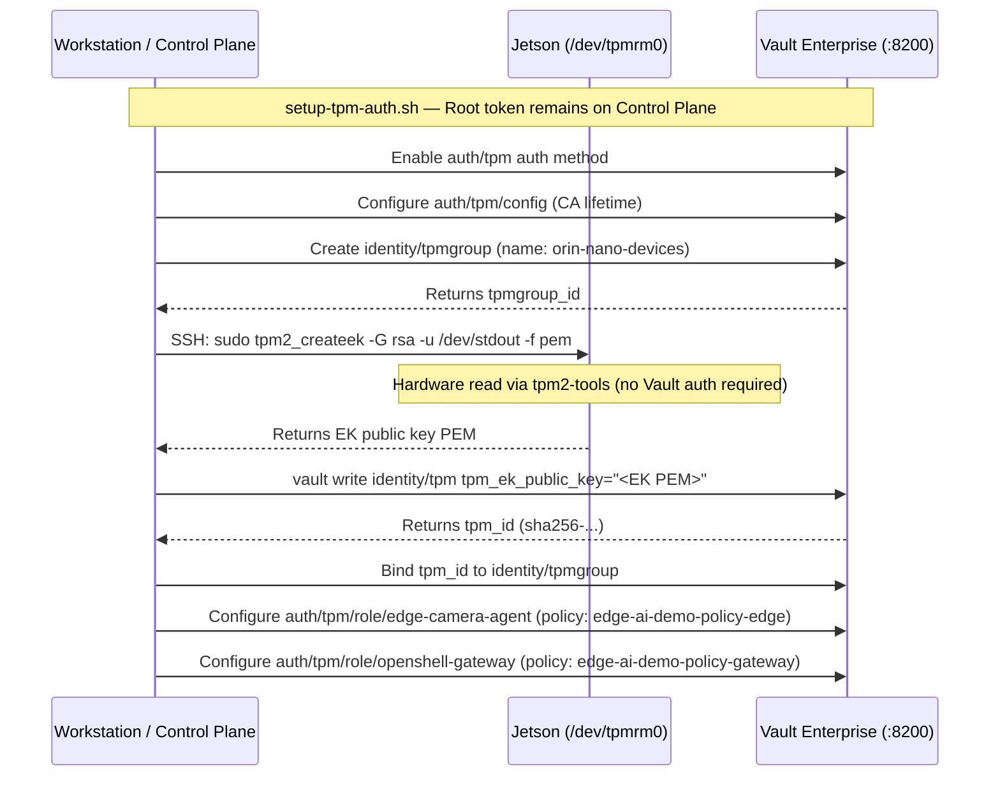

# Hardware TPM 2.0 Attestation & Vault Authentication Architecture

> **Document Purpose:** Describes the hardware-rooted TPM authentication and attestation workflows. No root token or long-lived secret ever touches the edge device storage.
>
> **Related Documents:**
> - System component topology: [`ARCHITECTURE.md`](ARCHITECTURE.md)
> - End-to-end credential flow sequence diagrams: [`CREDENTIAL_ARCHITECTURE.md`](CREDENTIAL_ARCHITECTURE.md)
> - Threat analysis and security register: [`THREAT_MODEL.md`](THREAT_MODEL.md)

---

## 1. Credential Security Posture

| Credential | Storage Location | Lifetime | Security Role |
|---|---|---|---|
| **Vault Root Token** &#42; | Control Plane only (`.vault-keys.json`, `chmod 600`) | Long-lived, operator control | Administrative cluster management |
| **TPM Endorsement Key (EK) Pubkey** | Extracted from silicon, transferred to Control Plane | Ephemeral in-flight | Registered in Vault `identity/tpm` (public material) |
| **TPM Client Cert (Edge Role)** | `/etc/vault-agent/tpm-edge/client.crt` | 24 hours (auto-renewed) | Machine identity proof for `trusted-edge` |
| **TPM Client Cert (Gateway Role)** | `/etc/vault-agent/tpm-gateway/client.crt` | 24 hours (auto-renewed) | Machine identity proof for OpenShell gateway |
| **Vault Token (Edge Role)** | `/run/openshell-edge/vault-token` (`0640 root:edge-ingest`) | 1 hour (auto-renewed) | Grants Transit datakey, dynamic DB creds, camera URL |
| **Vault Token (Gateway Role)** | `/run/openshell/vault-token` (`0640 root:jetson`) | 1 hour (auto-renewed) | Grants OpenShell provider credential resolution |
| **Static Bootstrap Secrets** | **None on edge device** | — | — |

> \* **Note — root token:** In this PoC the Vault root token is kept in `.vault-keys.json` on the control plane and is used by the Mac-side setup scripts (for example `vault/init-vault.sh` and `vault/setup-tpm-auth.sh`). It is never copied to the edge device. This is a PoC shortcut, recorded as [T-16](THREAT_MODEL.md#t-16). In production the root token should be revoked after initialisation and replaced by scoped admin tokens. Whether the TPM enrollment calls work with a scoped admin policy was not tested here (*unverified*).

---

## 2. Step 1 — Control Plane Remote Enrollment (`make setup-tpm-auth`)

---

## 3. Step 2 — Edge Device Hardware Attestation

```mermaid
sequenceDiagram
    participant Jetson as Jetson (/dev/tpmrm0)
    participant V as Vault Enterprise (:8200)

    Note over Jetson,V: 11-tpm-enroll-and-agent.sh — Unauthenticated hardware challenge/response

    %% Edge Agent Attestation
    rect rgb(20, 35, 50)
    Note over Jetson,V: Edge Agent Attestation (Role: edge-camera-agent)
    Jetson->>V: vault tpm attest -role-name=edge-camera-agent (VAULT_TOKEN="")
    Note over V,Jetson: Vault encrypts challenge with EK pubkey -> TPM decrypts with EK private key -> Vault verifies response
    V-->>Jetson: Generates client certificate -> /etc/vault-agent/tpm-edge/client.crt
    Jetson->>V: vault-agent.service starts (auto_auth method=tpm)
    V-->>Jetson: Token (edge role) -> /run/openshell-edge/vault-token (0640 root:edge-ingest)
    end

    %% Gateway Agent Attestation
    rect rgb(30, 25, 45)
    Note over Jetson,V: Gateway Agent Attestation (Role: openshell-gateway)
    Jetson->>V: vault tpm attest -role-name=openshell-gateway (VAULT_TOKEN="")
    Note over V,Jetson: Vault encrypts challenge with EK pubkey -> TPM decrypts with EK private key -> Vault verifies response
    V-->>Jetson: Generates client certificate -> /etc/vault-agent/tpm-gateway/client.crt
    Jetson->>V: vault-agent-gateway.service starts (auto_auth method=tpm)
    V-->>Jetson: Token (gateway role) -> /run/openshell/vault-token (0640 root:jetson)
    end
```

---

## 4. Step 3 — Runtime Auto-Auth & Autonomous Token Lifecycle

```mermaid
sequenceDiagram
    participant EdgeAgent as vault-agent.service
    participant GwAgent as vault-agent-gateway.service
    participant TPM as /dev/tpmrm0
    participant V as Vault Enterprise (:8200)
    participant EdgeCons as trusted-edge.service
    participant GwCons as OpenShell Gateway

    Note over EdgeAgent,GwCons: Continuous hardware-backed token renewal (~80% TTL)

    %% Edge Agent Loop
    rect rgb(20, 35, 50)
    EdgeAgent->>TPM: Present client certificate (/etc/vault-agent/tpm-edge/)
    EdgeAgent->>V: Authenticate via auth/tpm (TPM signs challenge)
    V-->>EdgeAgent: Edge Token (1h TTL, policy: edge-ai-demo-policy-edge)
    EdgeAgent->>EdgeAgent: Atomically update /run/openshell-edge/vault-token (0640)
    EdgeCons->>EdgeAgent: Read /run/openshell-edge/vault-token
    EdgeAgent-->>EdgeCons: Edge Token (file content)
    EdgeCons->>V: Request Transit datakey & dynamic DB credentials (5 min TTL)
    V-->>EdgeCons: Ephemeral DEK & dynamic DB credentials
    end

    %% Gateway Agent Loop
    rect rgb(30, 25, 45)
    GwAgent->>TPM: Present client certificate (/etc/vault-agent/tpm-gateway/)
    GwAgent->>V: Authenticate via auth/tpm (TPM signs challenge)
    V-->>GwAgent: Gateway Token (1h TTL, policy: edge-ai-demo-policy-gateway)
    GwAgent->>GwAgent: Atomically update /run/openshell/vault-token (0640)
    GwCons->>GwAgent: Read /run/openshell/vault-token via token_path
    GwAgent-->>GwCons: Gateway Token (file content)
    GwCons->>V: Read provider credentials under edge-ai-demo-gateway/
    end
```

---

## 5. Architectural Principles

### 1. Separation of EK Extraction and Registration
Per HashiCorp Vault architecture, reading the Endorsement Key is an unauthenticated hardware read performed on the edge node via `tpm2_createek`. Registering the public key in `identity/tpm` requires administrative privileges and is performed exclusively from the control plane using the Vault root token.

### 2. Unauthenticated Attestation Protocol
The `vault tpm attest` command communicates with Vault's `gentpmcert/begin` and `gentpmcert/finish` endpoints without requiring a bootstrap Vault token. Security is enforced cryptographically: Vault encrypts an attestation challenge to the enrolled EK public key, which can only be decrypted by the physical TPM hardware possessing the private EK.

### 3. Client Certificate Properties
The generated TPM client certificate is public identity material. It allows initiating an authentication handshake but cannot be leveraged on another machine, as completing the handshake requires active challenge signing by the physical TPM chip.
